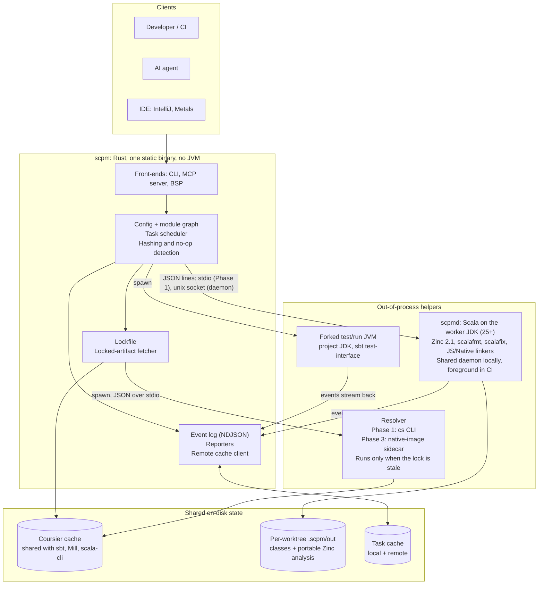

# scpm — design exploration

> Status: **exploration / RFC**. Written 2026-11-24. Name: `scpm` ("Scala package manager"), chosen after the collision check in
> [§13](#13-things-you-didnt-ask-about).
>
> Research inputs: pnpm 11/12 and aube docs, coursier 2.1.27 source and docs, bleep
> 1.0.0-M16, Metals v2.0.0-RC1, sbt 2.1, Mill 1.x, Zinc 2.1, JDK 25 Leyden JEPs, plus local
> measurements (marked *measured*). Claims we could not verify are marked **[unverified]**.

---

## 0. TL;DR — recommended decisions

| Question | Recommendation |
|---|---|
| Positioning | A **package-manager-first** workspace tool (pnpm/aube shaped) that also compiles, rather than a build tool that also resolves. bleep already ships much of the "fast build tool" half — see [§2](#2-landscape-and-what-bleep-already-did). |
| Config layout | **Split**: root `scpm-workspace.yaml` (members, catalogs, policy, tasks, pipelines, versioning) + one `scpm.yaml` per module (its deps, its tasks). Sharing via named **presets** + root-level **task defaults**. `scpm graph` / `scpm config --resolved` give back the single explicit view. |
| Config format | YAML with a published JSON Schema; unknown keys are errors with did-you-mean (pnpm 12 behaviour). |
| CLI language | **Rust.** It owns everything that does not need a JVM: config, graph, hashing, no-op detection, lockfile fetch, cache restore, reporting. |
| Compiler side | A **Scala JVM worker** (“`scpmd`”) that embeds **Zinc 2.1** directly — *not* Bloop. Narrow protocol: compile/test/run requests in, structured events out. All scheduling stays in Rust. |
| Daemon? | **Yes locally** (one shared per-user daemon per `(scpm version, worker JDK)`, idle-timeout, serves every workspace and worktree). **In CI, the same worker runs in the foreground for the life of the job** with a JDK 25 AOT cache. Zinc cannot be made fast enough cold: JIT warmup is 3.4–5× (*measured*). |
| Dependencies | **Coursier owns resolution and the cache.** Phase 1: spawn native `cs`. Phase 3: a small native-image resolver sidecar on the coursier API (JSON-lines over stdio). Never reimplement Maven resolution in Rust. |
| Lockfile | **Yes**, our own (`scpm-lock.yaml`), because nothing in the Scala ecosystem has one. Restoring from the lock needs no resolver, only intransitive downloads with sha256 verification, so the Rust CLI does it itself from Phase 1, writing a coursier-compatible cache layout. |
| Semver ranges | Allowed **only in manifests, only for direct deps, resolved at lock time**. Published POMs never contain ranges. `^`/`~` are translated with Scala's early-semver rules and the dependency's `info.versionScheme`. |
| Agents | **`scpm mcp`** is a first-class front-end from Phase 1. It is a thin layer over `--json` and the event stream, owns a foreground worker in Phase 1 and uses the shared daemon from Phase 2, and is token-frugal by default (§9.3). |
| Reporting | Everything is an **event stream** (NDJSON). Reporters (tty, GitHub, JUnit, JSON, SARIF, MCP) are consumers. The plugin API is mostly “subscribe to events / contribute facts”. |
| IDE | Write **`.metals/mbt.json`** for Metals v2's fast path (Scala 2.12, 2.13 and 3; full speed needs Scala 3.3.8+ or 3.8.4+). Serve a **narrow, well-implemented BSP**. For IntelliJ, add `scpm idea` (generated `.idea` XML) early and a native ExternalSystem plugin in Phase 5, so we're not stuck with IntelliJ's weaker BSP experience (§10). |
| Worktrees | Shared daemon + shared coursier cache + **copy-on-write seeding** of build outputs and portable Zinc analysis from a sibling worktree or the remote cache: `scpm worktree add` gives a warm incremental build. |

---

## 1. Goals and non-goals

**Priorities (from the brief):** speed, reportability, DX, in that order of tie-breaking.

Concretely:

1. **Cold CI start is effectively free.** A no-op or cache-hit `scpm pipeline` in a fresh GitHub Actions runner never boots a JVM. Target: < 300 ms of tool overhead on a warm runner cache for a 50-module workspace.
2. **Every result is structured.** Diagnostics, test results, dependency facts and timings are data first and text second. GitHub annotations, step summaries, JSON for agents and SARIF are all just renderings of that data.
3. **Config is data, not code.** No compiling the build to learn what the build is. Any tool (Renovate, an agent, `jq`, an IDE) can read and edit it.
4. **Familiar to anyone who has used pnpm**: workspaces, `workspace:` protocol, catalogs, filters, `tasks` / `pipeline`, `change` / `version` / lanes.
5. **Ecosystem-compatible**: same coursier cache, same Maven repositories, publishes normal POMs, consumable by sbt/Mill/Gradle users.

**Non-goals:**

- sbt's arbitrary task/setting graph with scopes (axes) and in-process plugins.
- Being a general polyglot build system (Bazel/Pants). JVM languages first: Scala 2.13/3 and Java, Kotlin maybe later.
- Our own dependency resolution algorithm.
- A plugin ecosystem that runs inside the build process.

---

## 2. Landscape, and what bleep already did

The research surprised us: **bleep has moved a long way since Bloop.** As of 1.0.0-M16 (Nov 2026, still milestone, essentially one maintainer):

- GraalVM-native CLI. It **replaced Bloop** with its own Zinc daemon, `bleep-bsp`, one per (bleep version × JVM) shared by every workspace. The maintainer's PR [#496](https://github.com/oyvindberg/bleep/pull/496) claims ~12 ms to connect and ~200 ms for a no-op compile of 34 projects.
- Portable Zinc analysis (path markers in the style of sbt 2's `MappedVirtualFile`). On a 78-project build, clean → pull → compile went from 22 minutes to 16 seconds.
- `--invalidated=origin/main` change detection plus an S3 remote cache.
- GitHub `::error`/`::warning` annotations, `$GITHUB_STEP_SUMMARY`, JUnit XML, `-o json`, and an **MCP server**.
- A single `bleep.yaml` with templates, `extends`, and a `cross:` matrix; sbt/Maven import.
- Their documented pain: users accumulate stale multi-GB daemons, which led to `bleep server ls/top`, an idle timeout and a heap governor.

Other relevant prior art:

- **sbt 2.x**: `sbtn` native client by default, hermetic task cache, Bazel-compatible remote cache.
- **Mill 1.x**: native launcher, daemon by default, and declarative `build.mill.yaml` since 1.1.
- **scala-cli**: Bloop by default.
- **Metals v2** (RC1, Oct 2026): builds its own index and needs build tools mostly for *metadata* (`mbt.json`).

**What scpm does that bleep doesn't** (the reason to exist rather than contribute):

| | bleep | scpm |
|---|---|---|
| Mental model | Build tool | Package manager + workspace orchestrator (pnpm) that compiles |
| Config | One root file + templates | Workspace file + per-module manifests (pnpm) |
| Lockfile | None found **[unverified]**; user-level resolve cache | Committed `scpm-lock.yaml` with sha256, toolchain pinned too |
| Version ranges, catalogs, `workspace:` protocol | Not like pnpm | First-class |
| CI fast path | Native CLI → JVM daemon | **No JVM at all** on no-op/cache-hit paths (lockfile restore, remote cache, annotations all in Rust) |
| Remote cache | Explicit `pull`/`push` | Transparent inside `scpm pipeline` |
| Release management | — | changes / version / lanes / ledger, MiMa-checked bumps |
| Task graph | Fixed built-ins + scripts | pnpm-style `tasks:` with `^dep` edges, inputs/outputs caching |
| CLI language | GraalVM (lost Intel-mac binaries with GraalVM 25) | Rust (cross-compiles everywhere) |

**Open strategic question:** bleep is open source (licence **[unverified — check before reuse]**). Its `bleep-bsp` Zinc-daemon work, portable analysis, and sbt importer are directly reusable ideas, and possibly code. It is worth one conversation with its maintainer before writing a compile server from scratch.

---

## 3. Architecture



Only the Rust box runs on every command. Everything in "Out-of-process helpers" starts only when the work needs it (§3.2).

### 3.1 Division of labour

**Rust CLI (`scpm`) does everything that does not need a JVM:**

- parse and validate config, expand presets and catalogs, build the module graph
- read the lockfile; fetch locked artifacts directly (HTTP + sha256) into the coursier cache layout
- fingerprint inputs (git blob OIDs where possible, as bleep and Metals v2 do) and decide no-ops
- schedule tasks; restore and push the remote cache; run shell tasks
- render every report; serve BSP and MCP front-ends

**JVM worker (`scpmd`) is deliberately dumb.** The request is "compile this module with this classpath, these sources and these options, analysis file here, mapping roots here". The worker streams diagnostics and progress events back, then returns the analysis and products. It has no notion of a workspace graph. The wire format is [docs/worker-protocol.md](worker-protocol.md) (JSON lines); the CLI normalises worker events into the §9.1 event schema (workspace-relative paths, `edit` shape, categories). Rust can therefore:

- swap the worker implementation (embedded Zinc today; a Leyden or CRaC snapshot tomorrow);
- run several workers;
- and keep the worker reusable by other tools.

This is the Pants/Bazel shape: a native orchestrator with persistent JVM workers, which is proven at scale.

**Resolver.** Coursier, out of process (see [§5](#5-dependencies-and-coursier)). It is only needed when the lockfile is stale, so in CI with `--frozen` it is never invoked.

### 3.2 Hot paths, and which ones touch the JVM

| Command | JVM? | Notes |
|---|---|---|
| `scpm install` / `scpm ci` with up-to-date lock | No | Rust fetches missing jars by URL + sha256. No POMs, no resolution rounds (§5.2). Phase 1 gets the JDK with `cs java-home` (native, cached). |
| `scpm install` with stale lock | `cs` (native) | Coursier resolves and downloads. 40–130 ms warm *measured* (cats-effect+circe → spark-sql). |
| `scpm compile` no-op | No | Fingerprint check in Rust; bleep's ctime-manifest trick (5 s → 5 ms per project). |
| `scpm pipeline` all cache hits | No | Restore outputs + replay logs/annotations from the remote cache. |
| `scpm compile` with changes | Yes | Daemon locally; foreground worker in CI. |
| `scpm test` | Yes | Forked JVM per test run (needed for isolation anyway). |
| `scpm graph`, `scpm why`, `scpm outdated`, `scpm deps --json` | No / `cs` | |

---

## 4. Configuration model

### 4.1 Single root config vs per-module manifests

| | Single root (sbt, bleep, Mill YAML) | Split (pnpm, Cargo, aube) |
|---|---|---|
| “Show me the whole build” | One file | Needs a command (`scpm graph`, `scpm config --resolved`) |
| Locality / ownership | Everything in one hot file: merge conflicts, CODEOWNERS can't be scoped | Deps sit next to code; CODEOWNERS per module; less churn on a shared file |
| Agents | Must edit a large shared file | Edit the module they are working in |
| Moving or copying a module | Edit two places | Move a directory |
| Startup cost | 1 parse | N parses — irrelevant in Rust (~hundreds of small YAML files in low ms), and cacheable by mtime |
| Shared settings | Templates in the same file | Needs an explicit sharing mechanism (below) |
| Familiarity for our target users | sbt/bleep users | pnpm/Cargo users |

**Recommendation: split, pnpm style.**

- **Root `scpm-workspace.yaml`** owns workspace-wide concerns:
  - members (globs)
  - catalogs, overrides
  - repositories and credentials references
  - toolchain defaults
  - presets
  - task definitions and pipelines
  - versioning and supply-chain policy
- **Each module's `scpm.yaml`** owns only its identity, its sources, its dependencies (including other workspace modules), its compiler and run settings, and its own task overrides.

The explicitness concern ("A depends on B, here are all my projects") is kept two ways:

1. **Inter-module edges are still declared explicitly** in the dependent's manifest, as pnpm does with `workspace:`.
2. Members are an explicit glob list in the root (or a literal list if you prefer). `scpm graph` prints the resolved whole.

A lone `scpm.yaml` with no workspace file is a valid single-module project, just as a lone `package.json` is.

### 4.2 Sketch: workspace file

```yaml
# scpm-workspace.yaml
$schema: https://scpm.dev/schema/workspace-1.json
scpm: 0.4.2                       # Phase 3: pinned tool version; older/newer binaries re-exec this one

modules:
  - modules/*
  - apps/*
  - '!**/fixtures/**'

organization: com.acme           # default groupId for publishing

toolchain:
  jdk: temurin:25                # project JDK: release target, runs tests and `run` (§6.3); workspace-only
  scala: catalog                 # default Scala version for modules (key `scala` in the default catalog)

repositories:
  - central
  - id: acme
    url: https://acme.jfrog.io/artifactory/maven
    credentials: env:ARTIFACTORY_TOKEN     # bearer token; or { user: env:U, password: env:P } (§5.7)
    # allowInsecureCredentials: true       # only for an http:// repository that must get credentials (§5.7)

lock:
  resolutionContext: { os: linux, arch: x86_64, jdk: 25 }   # the default (jdk = project JDK major); §5.4

catalog:                         # default catalog → referenced as `catalog`
  scala: 3.9.0                   # the key is the field's natural key: `scala` here, the coordinate for deps
  org.typelevel::cats-core: 2.13.0
  org.typelevel::cats-effect: ^3.6.0
  org.scalameta::munit: 1.2.1

catalogs:
  scala213:
    scala: 2.13.18
    org.typelevel::cats-core: 2.12.0
  spark:
    org.apache.spark::spark-sql: 3.5.1

boms:                            # applied to every module (Maven BOM import semantics via coursier)
  - com.fasterxml.jackson:jackson-bom:2.20.1

overrides:                       # forced versions, workspace-wide (coursier --force-version)
  com.google.guava:guava: 33.4.0-jre

presets:                         # named, mergeable fragments; modules opt in with `extends:`
  library:
    scalacOptions: [-deprecation, -feature, -Werror]
    publish: true
    versionScheme: early-semver
  cross-213-3:
    scala: [catalog, catalog:scala213]    # a list = cross-build over these Scala versions

tasks:                           # pnpm-style task defaults, inherited by every module
  compile: { dependsOn: ['^compile'] }   # built-in tasks need no `run:`
  test:    { dependsOn: [compile], outputs: [] }
  lint:    { outputs: [] }
  fmt:check: { outputs: [] }
  lint:strict:                   # custom task reusing a built-in with arguments
    run: builtin:scalafix --check --config .scalafix-strict.conf
    outputs: []

pipelines:
  default: [fmt:check, compile, lint, test]
  release: [compile, test, mima]

pipelineBase: origin/main

policy:
  minimumReleaseAge: 1d          # see §5.6
  versionConflicts: error        # sbt-style eviction errors using info.versionScheme

versioning:
  changes: .changes
  fixed: [[core, core-testkit]]
  lanes: { api-next: rc }
```

### 4.3 Sketch: module manifest

```yaml
# modules/core/scpm.yaml
name: core                       # artifactId = core_3 on publish (core_sjs1_3 for Scala.js)
extends: [library, cross-213-3]
platforms: [jvm, js]             # variants = platforms × scala versions → core@jvm-3, core@js-2.13, …

dependencies:
  org.typelevel::cats-core: catalog
  io.circe::circe-core: ^0.14.10             # range: resolved at lock time, see §5.5
  util: workspace:*                          # another module in this workspace
  com.acme:auth-client: 3.2.1                # plain Java artifact (single colon)

providedDependencies:
  org.apache.spark::spark-sql: catalog:spark

testDependencies:
  org.scalameta::munit: catalog

boms:
  - com.acme:platform-bom:2026.11.0

javacOptions: [-parameters]
generatedSources: [src_managed]  # Phase 3: dirs under ${outDir} that tasks write; compiled with the sources

variants:                        # per-variant overrides, keyed by variant selector, only when needed
  '2.13':                        # matches every variant on Scala 2.13 (also: 'js', 'jvm-3', …)
    scalacOptions: [-Xsource:3]
    compilerPlugins:             # coord → spec; added as -Xplugin
      org.typelevel:::kind-projector: 0.13.3

tasks:
  generate:                      # module-local task; codegen before compile
    run: scpm run codegen -- --out ${outDir}/src_managed
    outputs: ['${outDir}/src_managed/**']
  compile: { dependsOn: ['^compile', generate] }
```

```yaml
# modules/codegen/scpm.yaml
name: codegen
scala: none                      # Java-only: no Scala suffix, no scala-library; one variant, codegen@jvm
release: 17                      # Java release target; default: the project JDK's major version
mainClass: com.acme.codegen.Main
jvmOptions: [-Xmx1g]             # forked `run` / `test` JVMs
env: { CODEGEN_STRICT: 'true' }

dependencies:
  com.squareup:javapoet: 1.13.0
```

Notes:

- **Dependency syntax** keeps the Scala convention (`::` cross-version, `:::` full version, `:` plain Java). Keys are coordinates and values are version specs, so Renovate and agents can edit a single line. Bare names (`util:`) refer to workspace modules.
- **Scopes**: `dependencies`, `providedDependencies` (compile-only), `runtimeDependencies`, `testDependencies`. Four is deliberately small; no Ivy configurations.
- **Catalog references** look up the field's natural key: for a dependency, its coordinate (`catalog` → default catalog, `catalog:spark` → the `spark` catalog). The default catalog is written as a bare `catalog` (also accepted: `catalog:default`, or a quoted `'catalog:'`) because a trailing `:` is not valid in a YAML value (pnpm can use `catalog:` only because package.json is JSON). For `scala`, the natural key is `scala`. A catalog entry may itself be a range (`^3.6.0`); it is resolved once per (platform, Scala binary version) for the whole workspace (§5.4). A variant that needs a different version uses a `variants` override:
  ```yaml
  variants:
    '2.13':
      dependencies:
        org.typelevel::cats-core: catalog:scala213   # looks up org.typelevel::cats-core in catalogs.scala213
  ```
- **Source layout** is sbt/Maven's by default: `src/main/scala`, `src/main/java`, `src/main/resources`, `src/test/scala`, `src/test/java`, `src/test/resources`. Version- and platform-specific directories (`src/main/scala-2`, `scala-3`, `scala-2.13`, `scala-jvm`, `scala-js`, `scala-native`, and their `src/test/…` twins) are added automatically for the variants they match. `sources`, `resources`, `testSources` and `testResources` (lists of directories relative to the module) replace the defaults. They may point anywhere inside the workspace (a shared `../shared` directory is a common sbt layout); absolute paths and paths that leave the workspace root are errors.
- **`${outDir}`** is `.scpm/out/<variant-id>/`. `generatedSources` lists directories relative to it; tasks write them and they join the compile sources. Because tasks arrive in Phase 3, so does `generatedSources`; until then both are "not supported yet". In the sketches above, `tasks`, `pipelines`, `pipelineBase`, `generatedSources`, `policy` and `versioning` are later-phase keys.
- **`scala: none`** marks a Java-only module: no suffix, no scala-library, variant id `<name>@jvm`.
- **`compilerPlugins`** maps a coordinate to a spec, like dependencies. `:::` coordinates are resolved full-cross (`_<full Scala version>`). Every plugin jar is passed as `-Xplugin:<jar>`, Scala 3 plugins included.
- **Java and run settings:** `javacOptions`; `release`, the Java release target (default: the project JDK's major, §6.3); `mainClass`; `jvmOptions` and `env` for forked `run` and `test` JVMs.
- **Exclusions and classifiers** use an expanded object form when needed:
  ```yaml
  dependencies:
    org.foo:bar:
      version: 1.2.3
      exclude: [org.slf4j:*]
      classifier: linux-x86_64
  ```

### 4.4 Sharing from parent to child

pnpm has almost no inheritance; it relies on catalogs and root-level settings. We need slightly more because of scalac options and cross builds. Four mechanisms, in priority order:

1. **Catalogs.** Versions, defined once and referenced everywhere. Named catalogs replace sbt's `val catsVersion = …` idiom.
2. **Root `tasks:`.** Defaults inherited by every module and overridable per module (pnpm 12 semantics: an unconfigured task defaults to `dependsOn: ['^self']`, where `^self` means the same task in each upstream module).
3. **Presets + `extends:`.** Named fragments merged into the module in order, by the rules below. A `!replace` YAML tag on a value (`scalacOptions: !replace [-deprecation]`) replaces instead of merging. This is bleep's templates idea, but the presets live in the root and are referenced from leaves.
4. **Config dependencies** (later). Presets and catalogs published as a Maven artifact (`com.acme:scpm-presets:1.4.0`) and pinned in the lockfile's boot section, so an org can share them across repos. This mirrors pnpm's `configDependencies`.

Directory-based implicit inheritance (child configs silently picking up parent-directory config) is **not** supported: everything a module gets is visible from its own file plus `extends:`. `scpm config core --resolved [--json]` prints the fully expanded result, and `scpm config core --explain scalacOptions` shows where each value came from (as `aube config explain` does).

#### Effective variant config (normative)

**Order.** A variant's effective config is built by merging, later over earlier:

1. toolchain defaults (`toolchain:` in the workspace);
2. presets, in `extends` order. A preset may itself have `extends`; expansion is depth-first, each preset's own `extends` applied before the preset, and a preset already applied is skipped. A cycle is an error;
3. the module file;
4. each `variants` entry whose selector matches the variant, in file order (later wins). Entries contributed by presets come first; an entry repeated under the same selector merges into the first.

**Merge rules.**

| Value | Rule |
|---|---|
| Map | Merge by key, recursively. |
| Scalar | Later replaces earlier. |
| List | Append, **without** deduplication. |
| Set-like list: `extends`, `boms` | Append, deduplicated (first occurrence kept). |
| `scala`, `platforms` | Always **replace** (`platforms` is also deduplicated). They define the matrix, so a module's `scala:` overrides a preset's list rather than growing it. |
| Any value tagged `!replace` | Replaces. |

**Where keys may appear.**

- A preset may contain any module key except `name`.
- A `variants` entry may contain any module key except `name`, `extends`, `platforms`, `scala` and `variants`.
- `toolchain.jdk` is workspace-only in v1. A module sets its Java target with `release`.

**Variant ids** are `<module>@<platform>-<scala binary>` (`core@jvm-3`, `core@js-2.13`), or `<module>@jvm` for a Java-only module. A module's `scala` list may therefore hold at most one version per binary version; `[3.8.4, 3.9.0]` is an error.

**Selectors** (keys of `variants`, and the part after `@` in filters) have the form `<platform>`, `<scala>` or `<platform>-<scala>`, where `<platform>` is `jvm`, `js` or `native`, and `<scala>` is a Scala binary version (`3`, `2.13`) or a full version (`3.9.0`, `3.8.0-RC1`, which may itself contain `-`). A variant matches if every given part matches; a selector that matches no variant is an error. In filters, `-F core` matches every variant of `core`, and globs work (`-F 'core@jvm-*'`).

### 4.5 Cross-building

This is Scala-specific and has no pnpm analogue. A module's variants are `platforms × scala versions`, optionally pruned with an `exclude` list. A variant id looks like `core@jvm-3` or `core@js-2.13`; a Java-only module (`scala: none`) has one variant, `codegen@jvm` (id and selector grammar in §4.4).

- `workspace:` edges match variants by platform and Scala binary version, failing with a clear error when no match exists. An edge to a Java-only module matches any JVM variant.
- The lockfile has an entry per variant, resolved jointly with its upstream workspace modules (§5.4).
- Filters understand variants: `scpm test -F core@jvm-*`; `-F core` selects every variant of `core`.

### 4.6 Format choice

**YAML** with a published JSON Schema. Reasons:

- pnpm, aube and bleep use it, so our audience already knows it;
- editors give completion from the `$schema`;
- Renovate understands YAML.

TOML is the main alternative (Cargo, Mill YAML aside) and is arguably safer: there's no Norway problem, so `no` and `3.10` stay strings. We would mitigate YAML's pitfalls by treating every version field as a string in the schema and rejecting unquoted floats.

Unknown keys are **errors** with did-you-mean suggestions, matching pnpm 12's `ERR_PNPM_UNRECOGNIZED_WORKSPACE_SETTINGS`.

**The v1 schema is defined up front** and accepted from Phase 1. A key for a feature that isn't implemented yet is an error — "`<key>` is not supported yet (planned for Phase N)" — whenever it would change behaviour (`platforms: [jvm]` is fine in Phase 1; `platforms: [jvm, js]` is not). It is never silently ignored.

---

## 5. Dependencies and coursier

### 5.1 What coursier gives us (and what it doesn't)

**Coursier gives us** (verified against 2.1.27 source and docs):

- Maven and Ivy resolution with ~10 years of edge cases handled: parent POMs, properties, `dependencyManagement`, profile activation, relocations.
- **BOMs**: `--bom`, `Dependency.addBom`.
- Forced versions with patterns; exclusions; classifiers and types.
- Scala `::` and `:::` coordinates with platform suffixes for JS and Native.
- Reconciliation strategies and strict rules.
- Maven ranges and Ivy dynamic versions.
- Gradle Module Metadata (experimental).
- Offline mode; mirrors including `settings.xml`; credentials; proxies.
- Parallel downloads with retry/backoff and 429 handling.
- The shared cache used by sbt, Mill, scala-cli and bleep.
- JVM management (`cs java`, JVM index v2 with checksums).

**Coursier does not give us:**

| Missing | Notes |
|---|---|
| A lockfile | [coursier#1487](https://github.com/coursier/coursier/issues/1487) is still open; neither sbt, Mill, scala-cli nor bleep has one. |
| SHA-256 in its report | The report has no checksums or repository IDs. |
| A non-JVM API | No C ABI, no RPC. |
| npm-style ranges and semver conflict policy | Coursier reads `info.versionScheme` but doesn't enforce it. |
| “outdated / update” UX | |
| Publishing | `coursier/publish` is archived; it now lives on as `scala/scala-publish`. |
| Version-range unions | Only the last interval is kept. |

### 5.2 Using coursier from Rust

| Option | Verdict |
|---|---|
| Spawn native `cs` and parse `fetch -j` JSON | **Phase 1.** Zero build cost. `cs fetch` gives the graph as JSON; `cs resolve` is text only; versions come via `cs complete-dep org:name:` (text). There are hidden but real flags: `--bom`, `-V`, `--intransitive`, `--reconciliation`, `--strict`, `--rule`, `--checksum`, `-m offline`. The limitation is that errors are only stderr text. |
| Own resolver sidecar: a small Scala app on the coursier API, built with GraalVM native-image, JSON-lines over stdio | **Phase 3.** Structured errors, sha256 and repository per artifact, metadata-only resolution, version listing, and it can stay alive for a session. It uses coursier's own native-image configuration. |
| Host the resolver inside `scpmd` | A fine alternative once the daemon exists; but resolution should not *require* a warm JVM in CI, so keep the sidecar. |
| JNI or GraalVM `--shared` C library | Possible but adds little over a sidecar process. Skip. |
| Reimplement in Rust | **No.** The long tail costs months: profiles, BOM import cycles, relocations, Gradle variant matching, coursier's deliberate latest-wins semantics. The result would also diverge from sbt/Mill/scala-cli on the same inputs. Existing Rust crates (`jbuild`, `deps-maven`, `mvn`) are immature. |

The **one thing Rust does natively is restoring from the lockfile**, which is not resolution: it is "download these N files and verify sha256" into the coursier cache layout. It ships in **Phase 1**, behind a compatibility test suite that runs `cs` and the Rust fetcher concurrently on one cache.

- URL: the configured URL of the artifact's `repo` id (§5.4), with mirrors applied, plus the Maven path;
- path: `<cache>/https/<host>/<path>`, with coursier's escaping rules;
- write `.part` then rename;
- take POSIX `fcntl` locks to interoperate with the JVM's `FileChannel.lock` (**[verify on macOS]**);
- write no checksum sidecars: the sha256 from the lock is the check, and coursier fetches `.sha1` files on demand when it next verifies a file; files already in the cache are trusted when their size matches the lock, and `scpm install --verify` re-hashes them (re-downloading any that don't match);
- retry 429/5xx, transport errors and truncated bodies (a byte count other than the locked `size`), honouring `Retry-After` up to 30s;
- authenticate with the repository's `credentials` and, for repositories without them, coursier's own credential sources (§5.7), putting the matched user in the cache path (`<protocol>/<user>@<host>/…`) as coursier's `FileCache` does.

Release artifacts are immutable, so this is safe. Changing (`-SNAPSHOT`) artifacts are always delegated to coursier.

#### Who downloads what, and why

There are two cases, and **no single command chains a coursier resolve into a Rust download**. So there is no cross-tool waterfall.

| Case | When | Who does it | Requests |
|---|---|---|---|
| **Lock is stale** | `scpm add`, `scpm update`, a manifest edit | Coursier, resolving *and* downloading in one `cs fetch`. Rust only hashes the jars it got (local disk, no network) to write sha256 into the lock. | All POMs (with parent and BOM chains), then all jars |
| **Lock is fresh** | CI, a fresh clone, a new worktree, switching branches | Rust alone, from the coordinates, repository ids and sha256 values in the lock. No resolution at all. | Jars only, in one parallel burst |

**What coursier actually does** (verified in the 2.1.27 source: `Fetch.scala`, `ResolutionProcess.scala`):

- **No overlap between resolution and jar downloads.** `Fetch` resolves completely, then starts downloading jars.
- **Resolution runs in rounds with a barrier.** Each round fetches every missing POM in parallel; the next round starts only when the slowest one finishes.
  - Parent POMs cost one round per level.
  - Imported BOMs are only discovered once the parents are in, so they cost more rounds.
  - The critical path is roughly the deepest dependency path × (1 + parent depth + BOM depth) round-trips.
- **Concurrency defaults to 6 downloads.**
- **There is no "just download these" mode.** `--intransitive` still fetches each POM and its parents, and the `url=` dependency parameter still sends a HEAD request per artifact.

That serial depth is inherent to Maven resolution, and it's the real cost in a cold CI run. The lockfile removes it: every URL is known up front, so Rust can:

- **Skip POMs entirely.** That's roughly half the requests, and all of the serial rounds.
- **Use high concurrency over HTTP/2.** Many streams per host instead of 6 connections.
- **Verify sha256 from the lock.** Coursier only checks checksums that the repository serves, usually SHA-1.
- **Overlap downloads with other startup work**: starting `scpmd`, restoring the remote cache.

The POMs Rust skipped are not missing from anything that needs them. Coursier fetches them on demand the next time it resolves, and the coursier cache stays valid either way.

**Optional optimisation for the stale-lock case: speculative prefetch.** When the lock is stale, most entries in the *old* lock are still right. Rust can start downloading those jars while coursier resolves, and whatever coursier then asks for is already cached. Wrong guesses cost bandwidth but never correctness.

**Why not have coursier do the fresh-lock case too?** It can't do it without POMs from the CLI. It could through the library (`cache.file(artifact)` for each artifact, gathered), which a native-image sidecar could expose. But Rust already has the lock in memory, needs the sha256 checks anyway, and starting the fetch costs it no process spawn. The Phase 0 spike should measure a cold `cs fetch` against a Rust lock restore on a GitHub runner to quantify the gap.

### 5.3 Cache sharing

Use the user's existing coursier cache (`COURSIER_CACHE` or the platform default), so downloads are shared with sbt, Mill, scala-cli and bleep, and worktrees cost nothing extra.

In CI, the `setup-scpm` action caches it, keyed by the lockfile hash.

### 5.4 Lockfile: `scpm-lock.yaml`

Design goals, taking lessons from pnpm 12's experimental v13 lockfile format: few merge conflicts, one entry per artifact, sorted, stable.

```yaml
lockfileVersion: 1
resolutionContext: { os: linux, arch: x86_64, jdk: 25 }   # see below; a change re-locks every variant
bootInputs: sha256:…             # repositories + resolution context; a change re-resolves every boot entry

boot:                            # everything needed before a JVM starts; lists reference `artifacts`
  jdk:                           # planned format (not written by Phase 1): project JDK per os-arch, a JVM index id
    linux-x86_64:  { id: temurin:25.0.1 }
    macos-aarch64: { id: temurin:25.0.1 }
  scala-compiler@3.9.0: [org.scala-lang:scala3-compiler_3:3.9.0, org.scala-lang:scala3-library_3:3.9.0, …]
  compiler-bridge@3.9.0: [org.scala-lang:scala3-sbt-bridge:3.9.0]
  compiler-bridge@2.13.18+zinc-2.1.0: [org.scala-sbt:compiler-bridge_2.13:2.1.0]   # Scala 2 bridges come from Zinc
  worker: [dev.scpm:scpm-worker_3:0.4.2, …]
  test-runner: [dev.scpm:scpm-test-runner_3:0.4.2, org.scala-sbt:test-interface:1.0, …]
  tools:                         # planned format (not written by Phase 1)
    scalafmt@3.10.1: [org.scalameta:scalafmt-cli_2.13:3.10.1, …]
    scalafix@0.14.4: [ch.epfl.scala:scalafix-cli_2.13.18:0.14.4, …]

catalogs:                        # selections for catalog *ranges*, one per (platform, Scala binary version)
  default/org.typelevel::cats-effect@jvm-3: { range: ^3.6.0, version: 3.6.3 }

variants:                        # keyed by variant id, even for single-variant modules
  core@jvm-3:
    specifiers:                  # each direct dependency as written, and the version scpm selected
      org.typelevel::cats-core: { spec: catalog, version: 2.13.0 }
      io.circe::circe-core:     { spec: ^0.14.10, version: 0.14.14 }
      org.scalameta::munit:     { spec: catalog, version: 1.2.1 }
      util:                     { spec: 'workspace:*' }
    inputsHash: sha256:…
    compileClasspath:            # ordered
      - { module: util@jvm-3 }
      - org.typelevel:cats-core_3:2.13.0
      - io.circe:circe-core_3:0.14.14
      - …
    runtimeClasspath: [ … ]
    testCompileClasspath: [ … ]
    testRuntimeClasspath: [ … ]

artifacts:                       # group:artifact:version[:classifier][@type]; one entry per file
  org.typelevel:cats-core_3:2.13.0:
    repo: central                # repository id from config, never a mirror
    sha256: …
    size: 6012345
  io.netty:netty-transport-native-epoll:4.1.115.Final:linux-x86_64: { … }
```

#### Variants

Each variant locks four ordered classpaths:

| List | Contents |
|---|---|
| `compileClasspath` | `dependencies` + `providedDependencies` |
| `runtimeClasspath` | `dependencies` + `runtimeDependencies` |
| `testCompileClasspath` | `compileClasspath` + `testDependencies` |
| `testRuntimeClasspath` | `runtimeClasspath` + `providedDependencies` + `testDependencies` |

- **Workspace modules** (`workspace:*`) appear as references (`{ module: util@jvm-3 }`), not artifacts: every upstream variant in the transitive closure, in dependency order, before the external artifacts, which follow coursier's order. A direct `workspace:*` reference lands on the lists its declaring scope feeds (table above), so one under `testDependencies` is on the test lists only. From there the closure follows each upstream module's `dependencies` on every list and its `runtimeDependencies` on the runtime lists, never its provided or test dependencies.
- **Resolution is joint over the variant's transitive workspace closure.** A variant's external dependencies are resolved in one coursier call together with those of every upstream variant, so if A depends on B, A's classpaths hold one version of each library for both A's and B's code.
- **Catalog ranges are resolved once per (platform, Scala binary version) for the whole workspace**, so every variant that uses that catalog entry on that platform and Scala binary version gets the same version. The selection lives in the lock's top-level `catalogs` section, keyed `<catalog>/<key>@<platform>-<scala binary>`. Re-locking a stale variant reuses an existing selection whose range is unchanged; only `scpm update` re-selects, and it then re-locks every variant that uses the entry.
- **`specifiers`** records each direct dependency's spec as written and the version scpm selected for it (§5.5), before coursier's reconciliation, like pnpm's importers. `workspace:*` entries have no version.
- **`inputsHash`** is a sha256 over every effective input that affects the variant's resolution, after presets and `variants` (§4.4): platform and full Scala version, dependencies of every scope (catalog references replaced by their entries), `compilerPlugins`, BOMs, overrides, repositories (ids and URLs), the resolution context and `policy.minimumReleaseAge` / `minimumReleaseAgeExclude`, plus what joint resolution consumes from each upstream variant in its workspace closure: its compile and runtime dependencies, BOMs and Scala version. An upstream variant's test or provided dependencies and compiler plugins don't affect downstream variants, so editing them re-locks only that variant.
- A variant with `compilerPlugins` also has an ordered `compilerPlugins` list.

**Artifacts** are keyed `group:artifact:version[:classifier][@type]`, with `@type` omitted for `jar`. Each file has one entry, shared by every variant that uses it, holding `repo`, `sha256` and `size`. The lock records no dependency graph between artifacts: it would depend on the order variants happened to be locked in, so `scpm why` asks coursier instead (below). Declared classifiers and types (`classifier: sources`, `type: exe`, `aar`, `test-jar`, `bundle`, …) are locked like any other file, and a direct dependency that resolves to no file is an error naming it, except a plain POM-packaged aggregator (no classifier or non-jar type, such as `groovy-all`), which contributes only its transitive artifacts. **IDE sources jars are not in the lock.** They are fetched on demand and verified against the repository's checksum.

**Boot** holds the closures of the Scala compiler, compiler bridge, scpm worker, test runner and tools (scalafmt, scalafix), each a list of references into `artifacts`. A CI run can then fetch everything it needs in parallel from Rust before any JVM starts. `boot.jdk` is the project JDK (§6.3), keyed by `os-arch` (`linux-x86_64`, `macos-aarch64`, …). In Phase 1 it records only the JVM index id, which `cs java-home --jvm <id>` turns into a cached JDK; the Rust JDK fetcher (Phase 3) adds a URL and sha256 per entry. Boot entries re-resolve when their inputs change: a Scala 2 compiler bridge's key carries the Zinc version (`compiler-bridge@2.13.18+zinc-2.1.0`), and the top-level `bootInputs` hash covers the repositories and the resolution context, so changing either re-resolves every boot entry.

#### Resolution context and repositories

- **Resolution uses a fixed, declared context**, never the machine's own: by default `{os: linux, arch: x86_64, jdk: <project JDK major>}`, configurable as `lock.resolutionContext` in the workspace. It is passed to coursier, so a lock made on macOS equals one made on Linux. The lock records it, and a change re-locks every variant.
  - **Phase 1 limit:** the native `cs` CLI exposes only `--jdk-version`, so Phase 1 applies the JDK part of the context; OS and architecture profile activation follows the machine running `cs` until the resolver sidecar (Phase 3) passes them through the coursier API. The Phase 0 resolve spike checks how often this matters in practice. The lock does not record the resolving machine (that would make otherwise identical locks differ by who resolved them); `scpm install` reports it (`resolvedOn` in `--json`) and warns when it differs from the declared context, only when it actually re-locked something.
  - **Local-runtime trade-off:** with the default `linux-x86_64` context, a macOS developer's `run` and `test` get the artifacts a Linux profile selects (for example OS-classifier natives). Libraries whose natives differ by OS should be declared explicitly, one classifier per OS, in `runtimeDependencies`.
- **Mirrors** are applied at fetch time and never recorded. They are machine settings (§5.9).
- **`repo`** records the repository **id** from config, derived by matching the artifact's URL against the configured repository URLs (and their mirrors) by prefix, longest match first. A URL that matches no configured repository is an error. It is re-derived for every artifact a re-lock resolves, so after changing repositories (which re-locks every variant and boot entry) no entry points at a repository that is gone.

#### Staleness and commands

A variant is **stale** when its recomputed `inputsHash` differs from the lock's.

- `scpm install` — re-lock stale variants, then fetch whatever is missing.
- `scpm install --frozen` — the default when `CI=true`; a stale variant is an error.
- `scpm install --verify` — also re-hash cached files against the lock and re-download any that don't match.
- A corrupt or merge-conflicted lock is re-locked from scratch (with a warning); with `--frozen` (and so in CI) it is an error suggesting to resolve the conflict, or to re-create the lock locally with a non-frozen `scpm install` and commit it.
- `scpm compile|test|run` — locally, a stale lock is installed first (aube-style install-before-run) and scpm prints what changed. With `CI=true` or `--frozen`, a stale lock is an error.
- `scpm ci` — `scpm install --frozen`, then `compile` and `test` over the whole workspace; from Phase 3, `scpm install --frozen` then `scpm pipeline`.
- `scpm update [selector]` — re-resolve within the declared ranges.
- `scpm outdated` — list newer versions.
- `scpm why <coord>` — explain why a coordinate is on the classpath. It asks coursier: it rebuilds the variant's widest request (the test runtime classpath) at the locked versions and runs `cs resolve --what-depends-on org:name`, printing each chain from a direct dependency (and which variant declared it). If the artifact is on the classpath but coursier reports no chain, it says so.
- `scpm dedupe` — collapse duplicate versions.

### 5.5 Version ranges without breaking the ecosystem

The risk is that ranges in **published** POMs are bad for Maven consumers: they make builds non-reproducible, and Maven's handling of pre-releases and nearest-wins is surprising. So the rules are:

1. **Manifest syntax:**
   - exact: `1.2.3`, the default; `scpm add` writes exact versions unless `--save-range` is given
   - `^1.2.3`, `~1.2.3`, `>=1.2 <2`, `1.2.x`; bounds must be versions, and unions (`||`) are not supported
   - `catalog`/`catalog:<name>`, `workspace:*` (publishing always writes concrete versions, so there is no `workspace:^` or `workspace:~`)
2. **Bounds use Scala's early-semver rules**, or the dependency's `info.versionScheme` when it declares one:
   - `^1.2.3` → `>=1.2.3 <2.0.0`
   - `^0.14.10` → `>=0.14.10 <0.15.0`
   - `~1.2.3` → `>=1.2.3 <1.3.0`
3. **scpm selects the version itself and hands coursier an exact one.** For each range it:
   1. lists the available versions (coursier's version listing, or `maven-metadata.xml` per repository);
   2. drops pre-releases (and dynver `+<hash>` builds) unless the spec names one;
   3. honours qualifier flavours: if a bound carries a non-pre-release qualifier (`^33.0.0-android`), only versions with the same qualifier match; otherwise plain versions win over qualified ones (`42.2.29` over `42.2.29.jre7`);
   4. drops versions younger than `minimumReleaseAge` (§5.6);
   5. keeps those within the bounds and picks the highest.

   Ranges are **not** passed to coursier as Maven intervals: in Maven ordering `2.0.0-RC1 < 2.0.0`, so `[1.2.3,2.0.0)` would admit `2.0.0` pre-releases (MNG-3092). A catalog range is selected once per (platform, Scala binary version) for the whole workspace (§5.4).
4. **Only direct dependencies get ranges.** Transitive versions follow coursier's normal reconciliation. Ranges *inside* third-party POMs are honoured, because coursier does, and then pinned by the lock. A transitive version that violates `minimumReleaseAge` is an error naming the dependency path; fix it with an `overrides` pin or an exclusion.
5. **Ranges are resolved at lock time and never re-resolved implicitly.** A spec whose text is unchanged keeps its locked version even when its variant re-locks for another reason; only new or edited specs are selected (and `scpm update`).
6. **Publishing rewrites every spec to a concrete version.** The default is the **locked** version, which is what was actually tested, so Maven consumers see an ordinary POM. Option: publish the range's lower bound instead.
7. **Conflict policy:** after resolution, check every eviction against the evicted library's `info.versionScheme` (early-semver, pvp, semver-spec, strict, always), as sbt does. Fail with a readable diff that suggests an override.

Prior art: Gradle (dynamic versions + `gradle.lockfile`) is the only mainstream JVM tool with both ranges and locking. Bazel's `rules_jvm_external` locks via coursier's JSON report.

### 5.6 Supply-chain policy (cheap wins borrowed from pnpm 11 / aube)

- **sha256 in the lock**, verified on every fetch. Central reliably serves `.sha1` and `.md5` but not always `.sha256`, so we compute sha256 at lock time.
- **`minimumReleaseAge`.** Refuse to lock a version published less than N ago: ranges skip young versions, and a young transitive version is an error (§5.5). Use the POM's `Last-Modified` header (one HEAD request, only for *new* versions at lock time), the Central search API timestamp, or Artifactory's `createdAt` (§5.7). Overrides for security fixes are below.
- **`trustPolicy: no-downgrade`** for PGP or Sigstore signatures (later).
- **Vulnerability audit.** `scpm audit` checks every locked artifact in one `POST https://api.osv.dev/v1/querybatch`. OSV covers Maven, including GHSA data. OSV's Maven package names are `groupId:artifactId`, so Scala artifacts are queried with the suffixed artifactId, e.g. `org.typelevel:cats-core_3`.

#### Overriding the release-age gate for CVE fixes

Prior art:
- **pnpm**: `minimumReleaseAgeExclude` takes names, globs or exact versions. `pnpm audit --fix` *writes* an exact-version exclusion for you when the gate would block a patched version. Resolution itself has no automatic bypass.
- **scala-steward**: `updates.cooldown.minimumAge` with `skipForVulnerabilityCheck = true` (the default). Updates that fix a known OSV vulnerability skip the cooldown.
- **aube**: no advisory bypass at all.

scpm follows pnpm: **the bypass is explicit (`scpm audit --fix`) and always written down.** Resolution never calls an advisory database by default. A network lookup inside `install` would make locking depend on OSV's availability and on when an advisory happened to be published, and the lock should depend only on its inputs and the repositories. The scala-steward behaviour (security updates skip the cooldown automatically) lives in the update bot (§5.8), which runs `audit --fix` itself.

```yaml
policy:
  minimumReleaseAge: 1d
  minimumReleaseAgeExclude:
    - com.acme:*                                   # our own artifacts: always exempt
    - coord: com.fasterxml.jackson.core:jackson-databind@2.20.2   # exact version only
      reason: GHSA-xxxx-xxxx-xxxx                   # written by `scpm audit --fix` / the update bot
      expires: 2026-12-24                          # removed by `scpm audit --prune` once the version ages in
  securityBypass: off                              # default; `advisory-fixed` = also bypass during install (opt-in)
```

How it works:

0. `scpm audit` sends every locked artifact to OSV in one `querybatch` request and only reports. When `install` rejects a version for being too young, the error suggests `scpm audit --fix` but doesn't look anything up itself.
1. `scpm audit --fix` (or the update bot, §5.8) finds the **smallest version that the advisory lists as fixed** for each vulnerable locked artifact.
2. If the age gate blocks that version, scpm adds an **exact-version** exemption with the advisory ID and an expiry, then updates the lock. The exemption never covers a package glob or a range, so a later malicious release isn't exempted too.
3. The exemption shows up in the PR diff, where a reviewer sees *why* a 3-hour-old jar is being pulled.
4. A one-off override for local experiments is `scpm add … --allow-young`. It is never valid with `--frozen`.

The trust anchor is the advisory database's "fixed in" data (curated GHSA/OSV), not the package author's claim. That's what makes the bypass acceptable, explicit or automated.

**Opt-in `securityBypass: advisory-fixed`.** For teams that want scala-steward's behaviour during ordinary installs: when the gate would block a version that is being selected, scpm queries OSV for that artifact. Results are cached briefly. If an advisory affecting the current version lists the blocked version as fixed, scpm allows it and writes the same exemption entry. Never with `--frozen`. If OSV is unreachable there is no bypass, just a warning, and the install never fails because of it.

- **Compile-time code execution.** Macros and compiler plugins run arbitrary code at compile time, so an `allowBuilds` analogue can't be enforced the way npm's lifecycle scripts can. At minimum, report which deps contribute compiler plugins or annotation processors.

### 5.7 Enterprise repositories (optional fast paths)

**Credentials.** A repository's `credentials` is either `env:VAR` (sent as a bearer token) or `{user: env:U, password: env:P}` (basic auth). Phase 1's Rust fetcher reads those, plus coursier's `COURSIER_CREDENTIALS` / `credentials.properties` for matching hosts. Coursier's credential sources only express basic auth, so when `cs` resolves a stale lock scpm passes a bearer token as a basic-auth password of the user `token` (which Artifactory and GitHub Packages accept) **[verify per repository type in Phase 1]**. Secrets never go on `cs`'s command line (a repository URL with `user@` is rejected): scpm writes them to a private (0600) temporary file that `COURSIER_CREDENTIALS` names for the `cs` process, scoped to the repository's scheme, host and port (coursier 2.1.27's `scheme://host:port` form). Coursier's own entries are read by scpm, matched the same way (a realm-scoped one only after a challenge naming its realm) and passed to `cs` through that file, so both paths apply one policy. Credentials in the Scala CLI config (`scala-cli config repositories.credentials`) are not used: coursier would read them alongside that file, so `cs` gets a `SCALA_CLI_CONFIG` that names no file. Where machine-local credentials, mirrors and proxies come from, and how `cs` is kept from reading other sources, is §5.9.

**Plain HTTP.** Credentials only go over HTTPS by default. Configured `credentials` on an `http://` repository are a config error unless the repository sets `allowInsecureCredentials: true`; coursier entries that would go over plain HTTP (`https-only=false`, or an `http://` host) are dropped for every repository that hasn't opted in. With the opt-in, credentials go to exactly that repository's scheme, host and port, never to the rest of the host.

The environment variables are read only when needed: a frozen restore and `classpath` with every artifact cached work without them. `why` and re-locking start `cs`, which passes the credentials it can read and needs them for any POM it has not cached (a Rust restore fetches jars, not POMs). There a missing or empty variable leaves that repository's credentials out and is reported only as a note if `cs` then fails, so a successful `why` or re-lock doesn't show the credentials work. A Rust restore that must download from the repository fails on it.

Correctness always comes from coursier. These only speed up `outdated`, version listing and checksums:

**Artifactory**

- **OneModel GraphQL** (`POST /onemodel/api/v1/graphql`, Bearer token) is the batch path. One request covers many packages using GraphQL aliases, one per package:
  ```graphql
  query {
    cats: storedPackages { searchPackageVersions(
      where: { hasPackageWith: { name: "cats-core_3", typeIn: ["maven"] } },
      first: 50, orderBy: { field: VERSION, direction: DESC }) {
        edges { node { version createdAt } } } }
    circe: storedPackages { searchPackageVersions(
      where: { hasPackageWith: { name: "circe-core_3", typeIn: ["maven"] } },
      first: 50, orderBy: { field: VERSION, direction: DESC }) {
        edges { node { version createdAt } } } }
  }
  ```
  - `createdAt` also feeds `minimumReleaseAge`.
  - Requires Artifactory **7.104+**. Self-managed instances must set `metadata.onemodel.enabled: true`.
  - Alias batching is standard GraphQL, but JFrog's docs don't show it **[verify]**.
  - **Caveat: it indexes *stored* packages** (local repos and the cached part of remote repos), most likely not everything upstream on Central **[verify]**. So it can't be the only source for `outdated`.
  - Plan: query OneModel first, and fall back to `maven-metadata.xml` through the remote repo for anything it doesn't know.
  - The older Metadata GraphQL (`/metadata/api/v1/query`) exposes `latestVersion` and `versionsCount` on older instances.
  - AQL works too, but is capped at 3 concurrent queries and a 6,000-character body.
- `GET /api/search/latestVersion?g=&a=&repos=` — latest version, one package per call.
- `GET /api/storage/{repo}/{path}` — sha256 without downloading the file.
- Preemptive auth by default, because "hide existence of unauthorized resources" returns 404 instead of 401.

**GitHub Packages**
- `maven.pkg.github.com/OWNER/REPO`.
- Auth is required even for public packages, and only classic PATs or `GITHUB_TOKEN` work. Coordinates must be lowercase.
- **GraphQL for packages is deprecated for Maven.** Use REST `GET /orgs/{org}/packages/maven/{name}/versions`, one package per call; there is no batch API.
- `scpm login github` could write coursier-format credentials from `gh auth token`.

**Maven Central**
- Search API for `outdated`.
- Send a tool-specific User-Agent (Central asks tools to identify themselves, and rate-limits with 429).

### 5.8 Keeping dependencies up to date (a scala-steward-style bot)

What exists today:

| Tool | Can it update an scpm workspace? |
|---|---|
| **pnpm** | Has no bot of its own: just `pnpm outdated` and `pnpm update -i`. pnpm users rely on Renovate or Dependabot, both of which understand pnpm catalogs. |
| **Dependabot** | **No.** It added sbt in May 2026 (version updates only, no security PRs), but it has no custom, regex or plugin ecosystem. A new ecosystem means a PR to `dependabot-core` that GitHub has to accept. The Dependency Submission API gives Dependabot *alerts* (not PRs) from our lockfile. |
| **Renovate** | **Mostly, today.** A regex or JSONata custom manager on `scpm.yaml` and the workspace catalog works with the `maven` datasource. JSONata can read the module's Scala version to build `cats-core_3` from `org.typelevel::cats-core`. The catch is the **lockfile**: regenerating it needs `postUpgradeTasks`, which require self-hosted Renovate or a paid Mend plan. The free hosted app can't run commands. |
| **scala-steward** | **Not without a code PR.** Each build tool is a `BuildToolAlg` in scala-steward that runs the tool to extract dependencies, and there is no plugin interface. It's a small PR given `scpm deps --json`, and it would bring scala-steward's real advantage: **Scalafix migrations on version bumps**. |

The manifest format already helps: every dependency is one `coord: version` line in YAML. Any bot can do a textual bump; the hard part is only the lockfile and the Scala suffix.

**Recommendation: layer it.**

1. **Phase 2: Renovate preset + lock fix-up action.**
   - Publish a shareable Renovate preset (`github>scpm-build/renovate-config`) with the JSONata manager.
   - Publish a small GitHub Action that runs on bot branches: `scpm install` (regenerates the lock), then `scpm audit`, then pushes a commit. This sidesteps `postUpgradeTasks`, so it works with the free hosted Renovate app.
2. **Phase 3: Dependency Submission** from the lockfile, for Dependabot alerts and the dependency graph.
3. **Phase 4: first-party `scpm upgrade` + `scpm-upgrade` GitHub Action.**
   - Built on `scpm outdated --json`, which already knows the lock, catalogs, ranges, `versionScheme`, release-age policy and advisories.
   - **Groups updates by catalog entry.** One catalog bump updates every module that uses it in one PR.
   - **Applies Scalafix migrations**, reusing scala-steward's public migration list.
   - **Labels PRs by semver risk**, using `versionScheme` and MiMa against the old version.
   - **Security fixes skip the cooldown:** the bot runs `scpm audit --fix`, so the exemption entry appears in the PR diff (§5.6).
   - **Opens PRs** with release notes and changelog links.
   - Because it runs inside the tool, it handles the lock, ranges and policy natively. No external bot can.
4. **Any time: upstream a scala-steward `BuildToolAlg` for scpm.** It's cheap and reaches teams who already run steward.

### 5.9 Machine-local settings

Some settings legitimately differ between a laptop and CI: a developer reaches Artifactory through the office mirror and a keychain token, while CI uses a secret in an environment variable. Other settings must never differ, because they change what a build resolves. scpm keeps the two apart, and it is the **only** program that reads the machine-local ones.

**Two kinds of setting.**

| Kind | Examples | Where it lives | Can it change the lock? |
|---|---|---|---|
| **Project**: *what* resolves | repositories, catalogs, BOMs, overrides, `lock.resolutionContext`, release-age policy | `scpm.yaml`, recorded in `scpm-lock.yaml` | Yes, and that is the point: it is reviewed and committed |
| **Machine**: *how the bytes are reached* | credentials, mirrors, proxies, the cache directory | the environment and the user config (below) | **No.** The lock pins repository ids and sha256 values (§5.4), and mirrors are never recorded |

A machine setting can therefore only decide whether a download *succeeds*, never *what* is downloaded. A difference between a laptop and CI fails loudly (a 401 naming the repository) instead of silently building something else. sbt draws this line less firmly: `~/.sbt/1.0/global.sbt` can add plugins and change settings, so the same commit builds differently per machine. scpm has no user-level file that can do that.

**The real risk is two downloaders, not two machines.** scpm downloads through two paths: `cs` when it re-locks (and for `why`), and the Rust fetcher when it restores (§5.2). Coursier reads a lot of ambient configuration by itself. Every source `cs` reads that scpm doesn't is a place where the two paths disagree on one machine: a re-lock succeeds because `cs` quietly found a mirror or a password, then a restore, or CI, fails, and nothing in the repository says why. Verified against `cs` 2.1.27:

| Source coursier reads | What it can set | Today |
|---|---|---|
| `COURSIER_REPOSITORIES`, Scala CLI `repositories.default` | default repositories | ignored: scpm passes `--no-default` and its own `--repository` list |
| `COURSIER_MIRRORS`, `COURSIER_EXTRA_MIRRORS`, `mirror.properties` in coursier's config directory (`COURSIER_CONFIG_DIR`) | mirrors | ignored: `cs` gets a `COURSIER_MIRRORS` naming no file (which also disables `mirror.properties`), and no `COURSIER_EXTRA_MIRRORS` (read even then) |
| Maven `settings.xml` (`~/.m2`, `$CS_MAVEN_HOME/settings.xml`, `$MAVEN_HOME/settings.xml`, `COURSIER_MAVEN_SETTINGS`) | mirrors, `<server>` credentials for mirrors, proxies | ignored: `cs` gets `COURSIER_MAVEN_SETTINGS=false` |
| Scala CLI config (`SCALA_CLI_CONFIG`) | credentials, mirrors, default repositories | ignored since M2: `cs` gets a `SCALA_CLI_CONFIG` that names no file |
| `COURSIER_CREDENTIALS`, `credentials.properties` | credentials | read by scpm and passed on, one policy for both paths (§5.7) |
| JVM properties (`https.proxyHost`, …) | proxies | replaced: `cs` ignores `HTTPS_PROXY`, so scpm passes its resolved proxy as `-J-D` properties, and the Rust fetcher gets the same proxy explicitly with reqwest's environment lookup off |
| `COURSIER_TTL`, `COURSIER_MODE` | cache policy | ignored: removed from `cs`'s environment |

A mirror from `settings.xml` with `<mirrorOf>*</mirrorOf>`, common in companies, used to break re-locking: `cs` downloads from the mirror, the URL matches no configured repository, and the lock refuses it (§5.4). The error was loud but baffling.

**Rule: `cs` runs sealed.** scpm resolves every machine setting itself, then hands `cs` exactly that and nothing else:

- `--no-default` and one `--repository` per configured repository, with mirrors already applied (so `cs` asks the mirror directly);
- `COURSIER_CREDENTIALS` naming scpm's private credentials file (§5.7);
- `SCALA_CLI_CONFIG` and `COURSIER_MIRRORS` naming files that don't exist, `COURSIER_MAVEN_SETTINGS=false`, and `COURSIER_EXTRA_MIRRORS`, `COURSIER_REPOSITORIES`, `COURSIER_TTL` and `COURSIER_MODE` removed;
- the resolved proxy as JVM properties (`-J-Dhttps.proxyHost=…`, `-J-Dhttp.nonProxyHosts=…`).

The Rust fetcher gets the same resolved values: the same mirror URL, the same credentials and an explicit proxy, instead of reqwest's own environment lookup. Both paths see identical inputs by construction. The compatibility suite (§5.2) runs a re-lock and a restore under a hostile environment (every source above set to something wrong) and checks they still agree.

**Where machine settings come from**, highest precedence first:

1. **The project declares the need; the machine supplies the secret.** A repository's `credentials: env:ACME_TOKEN` in `scpm.yaml` (§5.7). The requirement is reviewed and committed, only the value is local, and a missing value fails with the variable's name: `repository acme needs ACME_TOKEN, which is not set`. This is the preferred form for anything CI must reach.
2. **The user config**, scpm's own file for machine settings: `<config dir>/scpm/config.yaml` (`~/.config/scpm` on Linux, `~/Library/Application Support/scpm` on macOS, `%APPDATA%\scpm` on Windows), or the file `SCPM_CONFIG` names. It holds only machine settings, never anything that could change the lock:
   ```yaml
   credentials:                       # matched by scheme, host and port, like §5.7; a path prefix narrows it
     - url: https://acme.jfrog.io
       token: env:ACME_TOKEN          # bearer; or user/password, each `env:VAR`, `file:PATH` or a literal
     - url: https://nexus.example.com/repository/
       user: alice
       password: file:~/.secrets/nexus
   mirrors:                           # applied at fetch time, never recorded (§5.4)
     - url: https://nexus.example.com/repository/maven-public
       mirrorOf: [central]            # repository ids, URL prefixes, or "*"
   proxy:
     https: http://proxy.example.com:3128
     noProxy: [localhost, .example.com]
   ```
   Literal secrets are allowed, as in `credentials.properties`, but scpm warns when the file is readable by group or others. A credential for a mirror is matched against the mirror's URL, not the repository it replaces.

   Details settled in the implementation:
   - The file is parsed strictly (an unknown key is an error, like the workspace files); a missing file, even one `SCPM_CONFIG` names, means no settings. `scpm schema user-config` prints its JSON Schema.
   - Item 1's `credentials` live on the repository definitions in `scpm-workspace.yaml`.
   - When several credential entries match a URL, the longest path wins. A `file:` value is read without one trailing newline; `~` is the home directory and a relative path is relative to the user config's directory.
   - **One origin, one set of credentials.** `cs` scopes credentials by scheme, host and port only, so a path can choose which credentials a repository gets but can't keep them from another URL on the same origin. When two repositories or mirrors that `cs` contacts share an origin but would get different credentials (or one gets none), scpm refuses to run `cs` and names both URLs instead of sending either set somewhere it wasn't meant for. Two GitHub Packages organisations with different tokens hit this; one token for both doesn't. The Rust fetcher knows each artifact's repository and is never ambiguous, so a restore isn't affected.
   - A mirror whose `mirrorOf` names the repository's id or a prefix of its URL wins over one for `*`; otherwise the first entry wins.
   - **A mirrored repository's workspace credentials are not sent to the mirror**, which is another host: they were declared for the repository. Its credentials are the user config's entry for the mirror's URL, else coursier's for the mirror's host.
   - **Plain HTTP:** user config credentials for an `http://` URL need the repository's `allowInsecureCredentials`, as coursier's entries do (§5.7). For a mirrored repository the opt-in covers the mirror's scheme, host and port, the origin actually contacted, and nothing else.
   - Repositories that share one mirror (`mirrorOf: ["*"]`) can't be told apart by URL; `cs` gets the mirror once. An artifact already in the lock keeps its repository id if that is one of them; a new one gets the first of them, in resolution order. Only a new artifact that the first repository lacks is then recorded differently from a resolution without the mirror.
   - **Proxies** are `http://host[:port]` (port 80 by default): `cs`'s JVM properties speak plain HTTP to the proxy, so `https://` and `socks5://` proxies are refused rather than handled differently by the two paths. A proxy URL with a user is refused too (proxy authentication is out of scope), and the error never repeats the URL. A `proxy` key in the user config replaces the environment entirely, even with no server in it. Of the environment variables, the upper-case form wins. A bad proxy in the user config is a configuration error; a bad one in the environment only fails a command that must download something.
   - `noProxy` entries cover a host and its subdomains (`domain|*.domain` for `cs`), `*` covers everything, and loopback (`localhost`, `127.0.0.1`, `::1`) is always direct, as in the JVM's default. Address ranges (`10.0.0.0/8`) can't be expressed to `cs`, so both paths drop them and `scpm config explain` lists them.
3. **Compatibility imports**, read by scpm and put through the same policy: coursier's `COURSIER_CREDENTIALS` / `credentials.properties` (§5.7), and the standard `HTTPS_PROXY` / `HTTP_PROXY` / `NO_PROXY` variables when the user config sets no proxy. People already have these for sbt and coursier, so they keep working, but scpm reports when it uses them.

**Ignored on purpose:** Maven `settings.xml`, coursier's mirror files and variables, the Scala CLI config, and JVM proxy properties. They belong to other tools, live in places nobody looks (coursier's macOS config directory is `~/Library/Application Support/Coursier`), and reading them live is how the two paths drifted. When one of them configures something for a repository or host the current command uses, scpm prints one notice naming the file and the setting, and how to move it (a planned `scpm config import maven` would convert `settings.xml` mirrors, servers and proxies into the user config, once and explicitly). There is no notice for sources that don't touch the repositories in use.

**Seeing it: `scpm config explain`.** Prints, per configured repository, the URL, the effective URL after mirrors, where its credentials come from (the variable or file name, never the value), and the proxy that applies, then every ignored foreign source it found that would have applied. `--json` gives the same for scripts and agents (§9.3).

```text
$ scpm config explain
central  https://repo1.maven.org/maven2/
         via mirror https://nexus.example.com/repository/maven-public/  (user config, mirrorOf central)
         credentials: user alice, password from file ~/.secrets/nexus  (user config)
         proxy: none (nexus.example.com matches noProxy)
acme     https://acme.jfrog.io/artifactory/maven/
         credentials: bearer token from env ACME_TOKEN (not set)  (scpm-workspace.yaml)
         proxy: http://proxy.example.com:3128  (user config)
config   ~/Library/Application Support/scpm/config.yaml
ignored  ~/.m2/settings.xml: mirror "corp" for * (https://corp.example/maven) (would apply to central, acme)
```

As implemented: credentials name their source (`scpm-workspace.yaml`, `user config`, `COURSIER_CREDENTIALS` or `credentials.properties`) and say when a variable is not set or a file is missing; notes say when a user config credential is held back by the plain-HTTP policy or workspace credentials are not sent to a mirror. `scpm config [targets]` still prints variants; a module named `explain` is selected with `-F explain`. Foreign sources are found by a shallow read: `settings.xml` mirrors (Maven `mirrorOf` rules), servers (by repository or mirror id) and active proxies (assumed to apply to every repository; `nonProxyHosts` is not evaluated); `mirror.properties` (`COURSIER_MIRRORS`, else coursier's config directory) and `COURSIER_EXTRA_MIRRORS` by `from` prefix; the Scala CLI config's `repositories.credentials` (by `host`) and `repositories.mirrors` (by `from`), matching every repository when entries have another shape. JVM proxy properties can't be detected. The notice names the first applying setting and counts the rest, and is printed (on stderr, and as `notices` in `--json`) only when the command contacted a repository (a re-lock, a download, `why`) or failed while doing so; `scpm config import maven` is planned, not implemented.

**Not in scope:** proxy authentication, and per-repository proxies. Both wait for a user who needs them; `cs`'s JVM proxy-auth properties need verifying first **[verify]**.

---

## 6. Compilation: daemon or not?

### 6.1 Measurements

*Measured* on an M2 Pro, JDK 25, a synthetic 40-file module of ~3k lines; numbers are noisy, about ±15%:

| | Scala 3.9 | Scala 2.13.18 |
|---|---|---|
| Cold first compile (fresh JVM, in-process) | 12.9–15.7 s | 9.9 s |
| Warm steady state (10th+ iteration) | ~3.2 s | ~2.9 s |
| Cold ÷ warm | **4–5×** | **3.4×** |
| Hello-world process | 1.5 s | 1.5 s |
| + JDK 25 AOT cache (JEP 483/514/515): hello | 0.78 s | 0.65 s |
| + JDK 25 AOT cache: first compile | 7.6 s (−41%) | 5.9 s (−40%) |

There is no maintained native-image `scalac` (the only one we found was a 2018 Scala 2.12 experiment).

**Caveat on the AOT rows.** The JDK AOT cache covers only classes loaded by the built-in class loaders from a class path matching the training run. These numbers ran scalac directly on the application class path. Zinc loads scalac through a per-Scala-version `ScalaInstance` class loader, so the gain may not carry over; the Phase 0 spike must measure through Zinc.

### 6.2 Conclusion

- **A warm JVM matters for interactive dev.** A 3.4–5× difference in compile time is the difference between a fast edit-compile loop and a slow one. There is no way around JIT warmup today: the AOT cache halves *startup*, but warm code still needs profiling. JEP 544 (AOT code compilation, JDK 28 EA) and CRaC (Linux) may change this later.
- **A daemon does *not* matter for CI, as long as one job uses one JVM.** What kills CI is a JVM per module (sbt forks, Maven reactor plugins) or `sbt` boot plus project loading. A foreground worker that lives for the whole `scpm pipeline` invocation pays warmup once per job.
- **The largest CI win is not compiling at all**: remote cache plus affected-only selection, as bleep's 22 min → 16 s result shows. Then come the AOT cache, the warm coursier cache, and the cached JDK.

### 6.3 Design

**Two JDKs:**

| | Worker JDK | Project JDK |
|---|---|---|
| Chosen by | scpm: the JDK pinned per scpm release (25+), or the project JDK if that is newer; obtained with `cs java-home` in Phase 1 | `toolchain.jdk` in the workspace |
| Runs | `scpmd`: Zinc, scalafmt, scalafix, linkers | tests and `run` (forked JVMs) |
| Also | The AOT cache applies here | Java release target: scalac `-release` / `-java-output-version`, javac `--release`; a module's `release:` overrides the default (its major version) |

scpm picks a worker JDK at least as new as the project JDK, so any release target can be compiled.

**Locally:**
- One shared `scpmd` per `(scpm version, worker JDK)` per user. It serves every workspace and worktree.
- It listens on a unix socket in `~/.cache/scpm/daemons/`.
- It shuts down after 1 h idle, with a heap cap and ZGC (bleep's defaults).
- `scpm daemon ls|top|stop|logs` with OOM reporting, so stale daemons don't pile up.
- `--no-daemon` runs the worker in the foreground.

**In CI** (detected via `CI=true`):
- Foreground worker, never detached.
- Started **in parallel with** lockfile restore and remote-cache restore, so JVM boot overlaps network I/O.
- It is started **only if** at least one compile task misses the cache.

**AOT cache:**
- Generated on first run per `(worker JDK, scpm version, Scala version)` and stored in `~/.cache/scpm/aot/`.
- The `setup-scpm` action caches it.
- We could also pre-build AOT caches per release for the common JDK/Scala pairs **[needs validation that the AOT cache is portable across machines with the same JDK build]**.

**Zinc 2.1, embedded directly:**
- **Portable analysis**: a `MappedFileConverter` maps paths to `${WS}/`, `${CACHE}/`, `${JDK}/` markers, so analysis can be shared across machines, worktrees and the remote cache.
- Scala 3 pipelining (now fixed in 2.1) for more parallelism.

**Why not Bloop:**
- We need structured diagnostics, cancellation, our own scheduling and portable analysis.
- bleep and Mill both moved off it or never used it, and bleep documented why.
- Its last remaining reason to exist (Metals v1 integration) is covered by BSP plus `mbt.json`.

### 6.4 Can the daemon be Rust?

**Partly, and that is the recommended shape.** Scheduling, file watching, hashing and caching could live in a long-running Rust process (`scpm watch`, `scpm bsp`). The compiler itself must run in a JVM, because scalac and Zinc are JVM programs and no native compiler exists. So:

- a Rust orchestrator, optionally long-lived for watch and BSP;
- with JVM compile workers behind a narrow protocol.

A Rust daemon is not needed for speed: the Rust CLI starts in about 1 ms.

---

## 7. Worktrees

Inspired by aube's and pnpm's global virtual store. In the JVM world most of it is free, because classpaths point into the shared coursier cache and nothing is symlinked per project.

| Resource | Sharing across worktrees |
|---|---|
| Dependency jars | Coursier cache (already global). |
| JDKs, compiler, tools | Coursier / `cs java` cache. |
| Compile daemon | One per `(scpm, worker JDK)` per user; workspaces are keyed by absolute path. |
| Build outputs + Zinc analysis | **Per worktree** (`.scpm/out/`), but **seeded** on creation (below). |
| Task-result cache | Global local cache at `~/.cache/scpm/tasks`, keyed by content hash, so a hit in one worktree is a hit in all. |

`scpm worktree add <path> <branch>` does the following:

1. Runs `git worktree add`.
2. Finds the nearest worktree, or remote cache entry, whose outputs were built from the merge base.
3. Clones those outputs copy-on-write: APFS `clonefile` or Linux reflink, with a plain copy as fallback.
4. Rewrites nothing, because the Zinc analysis is portable.

The first compile in the new worktree is then an *incremental* compile of the diff. That's the JVM equivalent of aube's "install after `git pull` in 192 ms", and it matters most for agents that create many short-lived worktrees.

`scpm worktree prune` cleans up the local task cache entries no worktree references.

---

## 8. Tasks, pipelines, filtering

We copy pnpm 12's semantics almost verbatim, so the docs can say "same as pnpm".

**Tasks**
- A task is identified as `<module>#<task>`.
- In `dependsOn`, `^task` means that task in each upstream module; a bare `task` means the same module.
- Tasks are scheduled as soon as their dependencies finish, not by topological level.
- `concurrencyGroup` limits apply machine-wide across processes, e.g. to limit concurrent test JVMs.
- `--dry-run --json` prints the graph; `--resume-from <module>` reruns a failed run.

**Built-in tasks** are implemented natively rather than as shell commands, and need no `run:`. A custom task that wants a built-in with arguments writes `run: builtin:<name> <args>`:
- `compile`, `test`, `run`, `console`
- `fmt`, `fmt:check`, `lint` (scalafix)
- `package` (jar, assembly), `link` (Scala.js / Native)
- `mima`, `doc`, `publish`

**Custom tasks** are either:
- shell commands (`run:`), or
- **script modules**: an ordinary module whose `mainClass` is run with its classpath (`run: scpm run codegen -- …`). This is bleep-style scripting without compiling the build definition.

**Filtering** uses pnpm's selector syntax:
- `-F core...` — core and its dependencies
- `-F ...core` — core and its dependents
- `-F '[origin/main]'` — modules changed since the merge base
- `-F ./modules/**` — by path
- `!` excludes
- Variant-aware: `core@jvm-3`, `core@jvm-*`; a bare `core` selects every variant.

**`scpm pipeline`** (the CI entry point from Phase 3; `scpm ci` = `scpm install --frozen`, then `scpm pipeline`):
1. Install: auto-install locally, an error on a stale lock in CI (§5.4).
2. Affected modules plus dependents, since `pipelineBase`. A module also counts as changed when one of its catalog entries changes.
3. Restore from cache.
4. Run the graph, continuing past failures so every error is reported in one run.
5. Push to the cache.
6. Render reports.

**Caching**
- Opt-in via declared `outputs`; `outputs: []` makes tests and lints cacheable.
- The key covers:
  - inputs (git blob OIDs of tracked files, plus hashes of untracked non-ignored files)
  - the task definition
  - upstream task keys
  - the variant's lock entry
  - toolchain IDs
  - declared env vars
- On a hit we restore outputs and **replay the event log**, so annotations still appear on a cached run.
- Remote cache: speak an existing protocol, either the Turborepo Remote Cache HTTP API (what pnpm 12 uses) or the Bazel remote cache. Entries are signed and verified against `trustedKeys`. An unreachable cache never fails the build. GitHub Actions cache can also serve as a backend.

---

## 9. Reporting (the plugin API's centre of gravity)

### 9.1 Event stream

Every run writes `.scpm/runs/<run-id>.ndjson` and streams the same events to reporters. Sketch of the schema:

```jsonc
{"t":"run.start","run":"r_…","argv":[…],"ci":"github"}
{"t":"task.start","task":"core@jvm-3#compile","cached":false}
{"t":"diagnostic","task":"core@jvm-3#compile","severity":"error","file":"modules/core/src/Foo.scala",
 "range":{"start":{"line":41,"col":7},"end":{"line":41,"col":19}},"code":"E007","category":"type-mismatch",
 "message":"Found: Int\nRequired: String","rendered":"…ansi…","actions":[{"title":"Insert .toString","edit":…}]}
{"t":"test.case","task":"core@jvm-3#test","suite":"FooSuite","name":"parses","status":"failed","durationMs":12,
 "failure":{"message":"…","file":"…","line":88}}
{"t":"dependency.fact","module":"core@jvm-3","coord":"io.circe:circe-core_3:0.14.14","scope":"compile","direct":true}
{"t":"task.end","task":"core@jvm-3#compile","status":"failed","durationMs":2140}
{"t":"run.end","status":"failed","summary":{…}}
```

Diagnostics carry Scala 3 error codes and structured actions (Scala 3's `-rewrite` / actionable diagnostics), so agents can apply fixes mechanically.

### 9.2 Reporters

| Reporter | Notes |
|---|---|
| `tty` | Default for interactive use; pnpm-like compact progress. |
| `plain` | Default when not a TTY; terse; tuned for agents and token budgets. |
| `json` | `--json` on every command, stable schema, documented exit codes. |
| `github` | Automatic when `GITHUB_ACTIONS=true`; see below. |
| `junit` | Per test task. |
| `sarif` | Upload to code scanning, for persistent findings such as warnings and lint. |
| `mcp` | `scpm mcp`, see §9.3. |

**GitHub specifics:**
- Workflow-command annotations are capped (reported as 10 per type per step and 50 per job, **[verify]**) and truncate silently. scpm therefore:
  1. ranks diagnostics: errors first, then files changed in the PR, then warnings;
  2. emits up to the cap;
  3. writes the full table to `$GITHUB_STEP_SUMMARY`;
  4. states "N more" explicitly;
  5. can optionally create a **Check Run** via the Checks API, which allows 50 annotations per update and multiple updates.
- **Dependency Submission API**: upload a dependency snapshot from the lockfile, so GitHub's dependency graph and Dependabot alerts work for Scala. sbt only gets this through a separate action.

### 9.3 MCP server (`scpm mcp`)

Agents are a primary user, so the MCP server is a first-class front-end next to the CLI and BSP, not an afterthought. It is a thin layer: every MCP tool maps onto a CLI command's `--json` output, and the same event stream backs both, so the two can't drift apart.

**Design rules**

- **Token-frugal by default.** A green compile returns about one line (bleep reports 25 tokens, versus 31k for `mvn test`). Failures return structured diagnostics, capped and ranked like the GitHub reporter, with a `more` cursor to page through the rest.
- **Long operations stream progress.** They return a run ID that can be polled or cancelled, so an agent is never blocked waiting on a 3-minute test run.
- **Uses the shared daemon.** The MCP server is a Rust process. From Phase 2 it reuses the warm `scpmd`, so it starts nothing heavy and serves every worktree an agent opens. In Phase 1, before the daemon exists, `scpm mcp` owns a foreground worker for its lifetime.
- **Edits go through the same code paths as the CLI.** `add_dependency` edits the YAML (preserving comments) and updates the lock, exactly like `scpm add`.
- **Tools are scoped to the workspace root it was started in.** It never touches paths outside that root.

**Tool surface (first cut)**

| Tool | Returns |
|---|---|
| `compile(filter?)` | status, diagnostics (with Scala 3 codes and fix actions) |
| `test(filter?, testName?)` | status, failed cases with message and location |
| `diagnostics(file?)` | current diagnostics from the last run, without rebuilding |
| `graph(filter?)`, `why(coord)` | module graph, dependency path to a coordinate |
| `config(module, resolved?)` | the module's manifest, optionally fully expanded |
| `add_dependency`, `remove_dependency`, `update(selector)` | manifest and lock diff |
| `outdated(filter?)` | available updates, with advisory info |
| `classpath(module, scope)` | for agents that want to run tools themselves |
| `run(module, main?, args)` | output, capped |
| `explain(code)` | long-form explanation of an scpm or compiler error code |

**Resources:** `scpm://workspace` (module list), `scpm://module/<id>` (resolved config), `scpm://run/<id>` (event log of a run).

### 9.4 Plugins: out-of-process, data-first

Ordered by how much we expect people to need each kind:

1. **Shell tasks and script modules** cover most "plugin" needs: codegen, buildinfo, docker, assembly.
2. **Reporter plugins**: executables that read the NDJSON event stream from stdin. They are trivial to write in any language.
3. **Provider plugins**, launched over a JSON-RPC protocol. These are executables or coursier-launched JVM apps that the tool can *ask* for things:
   - source and resource generators (`generate(module) -> files`)
   - extra facts: licences, SBOM entries, vulnerability data
   - extra task kinds
   They're declared in the workspace, and the plugin artifacts are pinned in the lockfile's boot section.
4. **No in-process API.** Plugins never reach into the build model at runtime. This keeps startup fast and the config inspectable, and avoids the binary-compatibility treadmill sbt plugins live on.

---

## 10. IDE integration

### 10.1 Metals

- **Metals v2: write `.metals/mbt.json`** on `install` and whenever config changes. Metals v2's language server reads only that file, never the build files directly. It contains dependency modules (jar and sources), per-namespace sources, `dependsOn`, scalac and javac options, `javaHome`, and main and test classes. This puts us on Metals v2's fast path with no build-server round trips.
- **Scala versions.** v2 (2.0.0-RC1) is **not Scala 2-only**, although its build file lists only 2.12/2.13: that list covers the presentation compilers Metals builds itself.
  - Scala 3's presentation compiler ships inside scala/scala3 and v2 uses it.
  - v2's test suite runs mbt.json with mixed 2.13 and 3 modules.
  - **v2's sourcepath-based fast navigation needs Scala 3.3.8+ (LTS) or 3.8.4+.** Older Scala 3 compilers silently ignore the sourcepath and probably fall back to slower behaviour **[inferred]**.
  - `scpm doctor` should warn when a module's Scala 3 version is below that floor.
- **Metals v1** is still maintained in parallel (1.6.9, with features landed twice), and the Metals site recommends it for smaller projects. It needs BSP, below.

### 10.2 IntelliJ: why BSP feels like a downgrade, and what to do about it

What actually differs between IntelliJ's *native* sbt import and a BSP import (from the intellij-scala `bsp-builtin` sources and the sbt 2 docs):

- **Same in both:** highlighting (IntelliJ's own type-checker by default), the project/module/library model (BSP import is itself an IntelliJ "ExternalSystem"), PSI refactorings and inspections.
- **Different:**
  - *Build*: native uses JPS plus IDEA's in-process Zinc; BSP sends `buildTarget/compile` to the server.
  - *Run/test/debug*: IntelliJ's own runners **only if** the server implements `jvmRunEnvironment` / `jvmTestEnvironment` well.
  - *Source jars*: quality depends on the server's `dependencySources`.
  - *Sync*: IntelliJ **ignores `buildTarget/didChange`**, so every build change needs a manual "Refresh". bleep#306, open since 2023.
  - *Other*: no sbt shell, and worksheets need a target picked by hand.
- sbt's own 2.x docs rate BSP import "less mature" than native import.

So the downgrade is mostly **server quality plus IntelliJ's weaker BSP sync UX**, not highlighting. To find out which baseline you're comparing to, import one project three ways: native sbt, sbt-BSP and bleep. If sbt-BSP is as bad as bleep, the problem is IntelliJ's BSP client; if only bleep is bad, it's bleep's server.

**Plan: offer three IntelliJ paths, cheapest first.**

1. **A good BSP server (Phase 2)**, needed anyway for Metals v1 and other editors.
   - Implement `jvmRunEnvironment`, `jvmTestEnvironment`, `dependencySources` and `javacOptions`/`scalacOptions` carefully, since those are what drive the native runners.
   - Its compile shares the daemon's warm Zinc, so there is no double compile.
2. **`scpm idea` (Phase 2)**, which generates `.idea/` module, library and SDK XML directly from the resolved config, like Mill's GenIdea.
   - Gets IntelliJ's native JPS build and runners today, with no plugin.
   - Costs: re-run on config changes (the CLI can do that automatically after `install`); IDE and CLI compile separately into different output dirs; generated sources must be produced first.
   - Mill's docs call GenIdea "probably the preferred way" for polyglot or unusual projects.
3. **A native IntelliJ ExternalSystem plugin (Phase 5).** This is what Gradle, Maven and sbt (via sbt-structure) do, and the real "native" experience: IntelliJ owns the project model and sync, with a choice of JPS or scpm builds.
   - **Much cheaper for us than for sbt.** sbt's importer has to run sbt plus a plugin to extract the structure. Ours just runs `scpm config --resolved --json` (the same model `mbt.json` comes from) and watches the YAML files, so sync is instant and automatic.
   - **This is a concrete differentiator.** bleep's IntelliJ plugin is only a BSP launcher and wrapper, not a native importer.
   - The cost is maintaining a Kotlin plugin against IntelliJ API churn. Start it once the config model has stabilised.

### 10.3 BSP scope

`scpm bsp` is a Rust front-end that delegates compile, test, run and debug to `scpmd`. The spec has been stagnant since 2.2.0-M3, so we implement a narrow, stable subset well rather than all of it.

---

## 11. Release management

Copied from pnpm 11.11+ with JVM-specific checks added:

- **`scpm change`** writes changesets-format intent files to `.changes/*.md`.
- **`scpm change check`** runs on every PR. Beyond pnpm, it **validates the declared bump against reality**:
  - runs MiMa on every Scala and Java module (bytecode compatibility), plus tasty-mima for Scala 3 modules (TASTy compatibility), against the last published version;
  - a binary-breaking change declared as a patch or minor fails;
  - this is checked against the module's `versionScheme`, which is also written to the POM as `info.versionScheme`.
- **`scpm version -r`**:
  - bumps versions;
  - propagates bumps through `workspace:` edges;
  - writes changelogs;
  - appends to an append-only **ledger** (`.changes/ledger.yaml`), so cherry-picks between release branches stay safe;
  - creates no commit.
- **Lanes**: a module on a lane releases pre-releases alongside stable modules. The format must sort correctly under **Maven/coursier version ordering**: `1.4.0-RC1`, `1.4.0-M2`, not pnpm's `-rc.1` **[verify coursier ordering of the chosen format]**. `scpm lane main -F mod` graduates a module back to stable.
- **Fixed groups** and **epics**, as pnpm defines them.
- **`scpm publish -r`**:
  - rewrites `workspace:`, `catalog:` and ranges to concrete versions;
  - signs with PGP (Central requires it), optionally adding Sigstore;
  - publishes to the Central Portal Publisher API (bundle upload, then poll status), GitHub Packages or Artifactory.
  - It may embed `scala/scala-publish`.

---

## 12. Answers to the open questions

**Single root config vs per-module?**
Split (§4). Explicitness is kept by explicit `workspace:` edges plus `scpm graph`. Sharing is via catalogs, root task defaults, presets with `extends:` and, later, config dependencies. There is no implicit directory inheritance.

**CLI language?**
Rust.
- Scala Native is out: there is no coursier core for it (only version-parsing and coordinate-parsing artifacts), multithreading only stabilised in 0.5.12, and Windows support is weak.
- scala-cli with GraalVM native-image is a credible second choice (bleep, Mill, sbtn and cs all use it). It would let the CLI share model code with the daemon. But it gives up the Intel-mac binary, needs one native build per OS and architecture, and makes the JVM-free fast paths (fetching, hashing, HTTP cache) less natural to write.
- The decisive argument is not the 1 ms vs 10–70 ms startup. It is that a Rust CLI can own *all* the non-compile work without a JVM.

**Can we call coursier from Rust?**
- Not directly: there is no C ABI.
- Spawn the native `cs` (~40–130 ms per warm resolve), then move to a native-image sidecar.
- Skipping coursier means reimplementing Maven resolution: months of edge cases, with results that diverge from the rest of the ecosystem. Don't.

**Rust CLI with a Scala daemon?**
Yes. That's the recommended architecture, with the daemon kept deliberately narrow.

**A Rust daemon calling scalac some other way?**
Only as an orchestrator. Compilation has to happen in a JVM (no native scalac), so it's a Rust orchestrator plus JVM workers.

**Is a daemon needed, or can Zinc start fast enough?**
- Locally: a daemon is needed. Cold is 3.4–5× slower than warm, and still ≈2–2.4× with an AOT cache (§6.1).
- In CI: no detached daemon. Use one foreground worker per job, an AOT cache, and above all the remote cache.

**How much can coursier do; where are its limits?**
See §5.1. It does resolution, BOMs, overrides, cache, mirrors, credentials and the JVM index. Its limits: no lockfile, no sha256 in reports, no semver policy, no publish, no non-JVM API, no range unions.

**Artifactory / GitHub extras?**
Optional fast paths for latest-version and checksum lookups, plus better auth UX (§5.7). There's also GitHub Dependency Submission and the Checks API (§9.2).

**Can we allow npm-style ranges without breaking the ecosystem?**
Yes, if ranges stay in our manifests and lockfile and never reach published POMs (§5.5).

---

## 13. Things you didn't ask about

1. **The name: `scpm`.** The original working name, `spm`, is Swift Package Manager. Collision check for the candidates (Homebrew, crates.io, npm, Repology, GitHub, Scaladex; trademarks **not** checked):

   | Name | Collisions | Notes |
   |---|---|---|
   | **stige** | None found | Norwegian/Danish for "ladder", and *scala* is Italian for "ladder/staircase". Distinctive and greppable. |
   | **scpm** | Only an obsolete SUSE 9-era binary | Self-explanatory ("Scala package manager"), unique token, a bit dry. |
   | **skal** | Small 2022 npm package | 4 letters, home row, "skål" pun. |
   | rung | Small Rust CLI with a `rung` binary, npm packages | Common word, so grep is noisy. |
   | spam | crates `spam` | Cute, but embarrassing in logs and search results. |
   | scap, scalino, cask, sk, scl | Real conflicts | Wikimedia/NIST SCAP, an active Scala Native tool, Homebrew Cask, skim, Red Hat SCL. Avoid. |

   Chose **scpm**. Before anything is public, still to do: check trademarks, and claim the crates.io, npm and GitHub org names and the `scpm.dev` domain used in the schema URL.
2. **bleep overlap.** Decide deliberately whether to compete, collaborate or fork (§2). At the very least, read bleep's compile-server and portable-analysis code before writing ours.
3. **JDK management** is part of "fast CI". Pin the project JDK in the lock (`boot.jdk`), so `actions/setup-java` isn't needed. Phase 1 obtains it with `cs java-home --jvm <id>` (native, cached); a Rust fetcher reading coursier's JVM index replaces that in Phase 3.
4. **Test running** is its own subsystem:
   - sbt `test-interface` for munit, ScalaTest, weaver and ZIO Test, in forked JVMs;
   - structured per-test events;
   - test sharding across CI matrix jobs (`scpm test --shard 2/4`, balanced by recorded durations);
   - flaky-test retry with reporting.
5. **Formatting and linting are first-class**, as they are in the TS world (`biome`, `eslint`):
   - scalafmt and scalafix run *inside the warm worker*, not via coursier-launched JVMs;
   - versions are pinned in the lock;
   - `scpm fmt` should feel instant.
6. **sbt import** decides adoption. Most target repos are sbt, so we need `scpm import sbt`:
   - run sbt once to dump settings, as bleep does;
   - generate the workspace, module manifests and catalogs;
   - map common sbt plugins (buildinfo, assembly, native-packager, scalajs-bundler, sbt-ci-release) to built-ins or script modules.
7. **Mixed Java and Kotlin.** Java is free via Zinc. Kotlin is a real ask in mixed shops; bleep cites it as a reason it dropped Bloop. Plan for Kotlin in the worker protocol even if it's not implemented.
8. **Scala.js and Scala Native linking.** These are long-running, memory-hungry tasks that belong in the worker too, with incremental linker state cached like Zinc analysis.
9. **Dependency update automation.** This is the first thing people automate. See §5.8 for the Renovate preset, lock fix-up action, and first-party `scpm upgrade` bot.
10. **Windows.** Unix sockets exist on Windows 10+, `fcntl` locking does not (coursier uses `LockFileEx` via the JDK there), and copy-on-write clones are only possible on ReFS. Decide early whether Windows is tier 1.
11. **Tool version pinning and self-bootstrap (Phase 3).** `scpm: 0.4.2` in the workspace file means any `scpm` binary re-execs the pinned version (bleep does this; so do pnpm's `packageManager` field and Corepack). Distribute via mise, Homebrew, `curl | sh`, a GitHub Action, and `cs install`.
12. **Telemetry.** None by default. Write local timing data to the event log instead. `scpm report --since 7d` gives people the performance insight without phoning home.
13. **Hermeticity limits.** Macros, annotation processors and `sourceGenerators` can read the filesystem and network. The cache key can't see that, so provide `inputs`/`env` declarations and an `--no-cache` escape hatch, and say so plainly in the docs.

---

## 14. Risks

| Risk | Mitigation |
|---|---|
| Scope: this is pnpm + sbt + changesets + turbo. | Strict phasing (see [roadmap](roadmap.md)): each phase must be useful on its own. Phase 1 alone (lockfile, catalogs, fast compile, GitHub annotations) is already better than the status quo. |
| bleep closes the gap first. | Differentiate on the package-manager half (lock, ranges, catalogs, releases); consider collaborating. |
| Writing to the coursier cache from Rust corrupts it. | The Phase 1 fetcher ships behind a compatibility suite that runs `cs` and Rust concurrently on one cache (locks, `.part` files). |
| Daemons accumulate memory (bleep's experience). | Idle timeout, heap governor, `scpm daemon top`, and one daemon per worker JDK rather than per workspace. |
| Zinc portable analysis has edge cases (Zinc 2.1 just fixed several). | Fall back to a full compile on analysis mismatch, and report it as an event so it's visible. |
| Ranges confuse users coming from Maven/sbt. | Exact versions by default; ranges opt-in per dependency. |
| Comment-preserving YAML round-trip editing is weak in Rust; it affects `scpm add` and the MCP edit tools. | Edit by span: parse with positions, splice the minimal text change into the original, re-parse to check. Refuse with a diff rather than reformat the file. |
